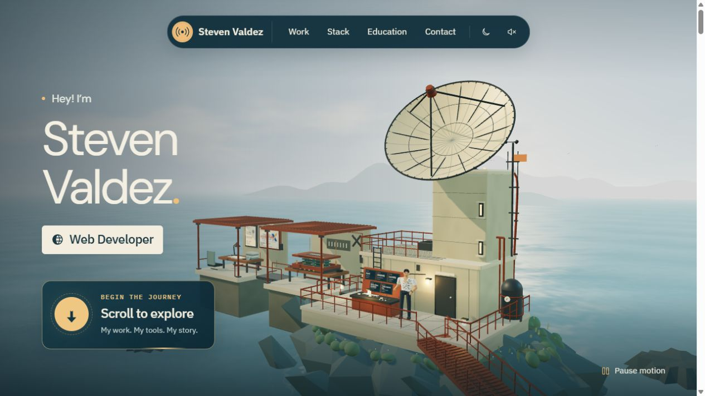
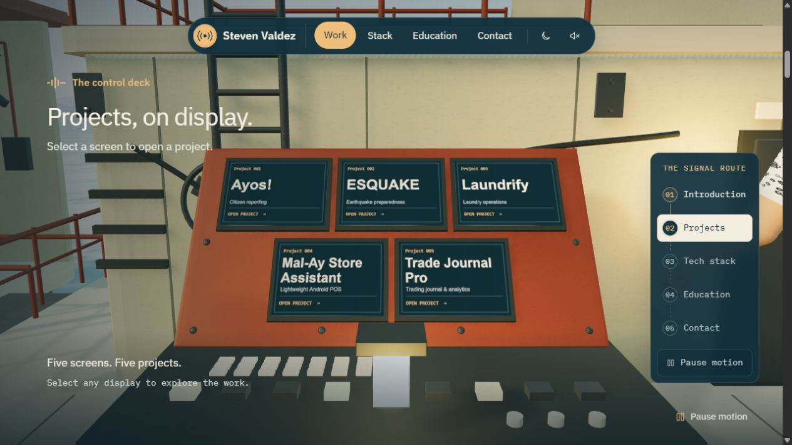
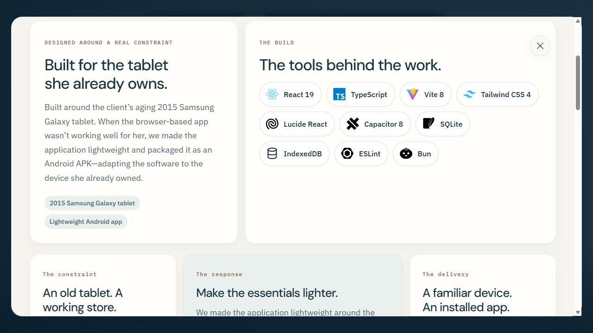
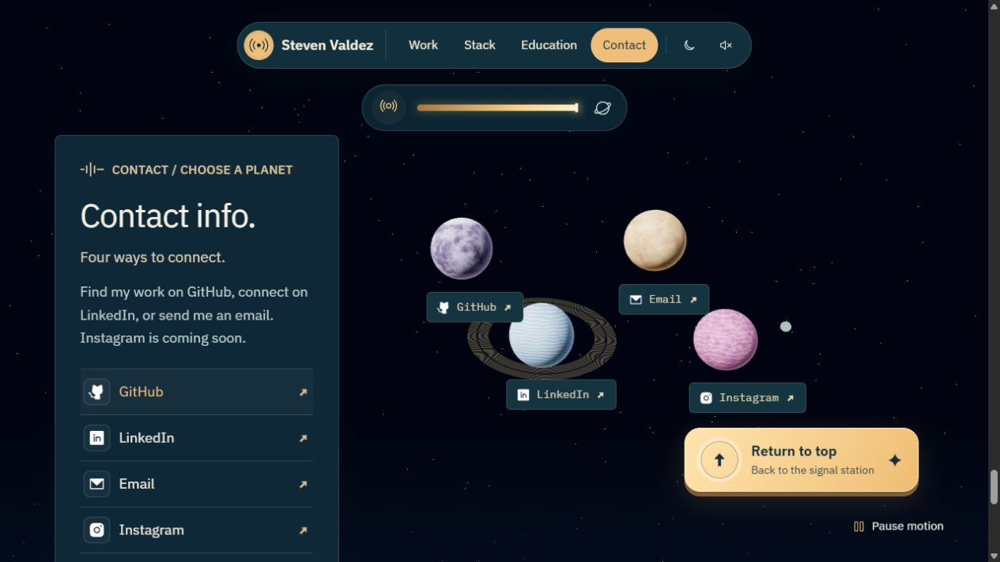

# Signal Station — Steven Valdez

### [Explore the live portfolio → stevenvaldez.me](https://stevenvaldez.me)

[](https://stevenvaldez.me)

An interactive portfolio set on a coastal communications station. Explore my work on the control deck, unpack the tools behind it in the workshop, and follow a satellite signal into space to connect.

I’m **Steven Valdez**, a software engineer and project manager based in Baguio City, Philippines. This portfolio brings together my web applications, game development, education, and leadership experience through one continuous journey.

## Explore the station

- **Projects:** Five interactive displays open case studies with project context, my contribution, technology logos, screenshots, and live demos where available.
- **Tech stack:** A disassembling workshop reveals the tools behind my work.
- **Education:** Select records on the study desk to explore my academic background, recognition, and campus leadership.
- **Contact:** Scroll—or launch the sequence with a click—to follow the uplink into a constellation of GitHub, LinkedIn, email, and Instagram destinations. Instagram is currently a placeholder.

The experience includes day and night modes, optional background audio and sound effects, keyboard-accessible controls, reduced-motion support, and motion pause controls. Space is the final stop; the return button takes you back to the station.

## A glimpse of the journey

| The control deck                                                                             | Inside a case study                                                                                |
| -------------------------------------------------------------------------------------------- | -------------------------------------------------------------------------------------------------- |
|  |  |

[](https://stevenvaldez.me)

**From the coast to the constellation.** [Take the journey at stevenvaldez.me](https://stevenvaldez.me).

## Featured work

| Project                    | What it explores                                                                                                                   |
| -------------------------- | ---------------------------------------------------------------------------------------------------------------------------------- |
| **AYOS!**                  | Citizen reporting for Baguio LGU; Philippine Startup Challenge X regional finalist.                                                |
| **ESQUAKE**                | An earthquake-preparedness serious game for CDRRMO Baguio City, developed as a university capstone.                                |
| **Laundrify**              | A laundry-management frontend for Gabriel’s Laundry Shop, covering counter operations, orders, customers, machines, and reporting. |
| **Mal-Ay Store Assistant** | A lightweight POS and inventory application packaged as an Android APK for a client’s aging Samsung Galaxy tablet.                 |
| **Trade Journal Pro**      | A full-stack trading journal with trade reviews, CSV imports, and performance analytics.                                           |

Each case study explains its scope, including prototype data, simulated behavior, and integrations that are not connected.

## Built with

The 3D world uses **Three.js and native JavaScript**, with HTML and CSS for the interface. A small **React, TypeScript, Motion, and Tailwind CSS** component powers the rotating hero roles. The production site is a static build hosted on Vercel.

Assets and third-party licenses are kept locally. Rendering work includes static mesh instancing, texture-based environment effects, and pausing background 3D rendering while reading project and education dialogs.

## Run locally

Use Node.js 22 or newer.

```sh
npm ci
npm run dev
```

Open [localhost:4175](http://127.0.0.1:4175/). The site does not require environment variables or API keys.

To build and preview the production version:

```sh
npm run build
npm start
```

For verification:

```sh
npm test
npm run typecheck
```

If you edit the React hero-title component, regenerate its checked-in assets with `npm run build:station-role`.

## Inside the repository

- `src/` — scene models, interactions, project content, and shared interface components.
- `assets/` — local artwork, logos, screenshots, fonts, and audio resources.
- `vendor/` and `licenses/` — vendored dependencies and license notices.
- `scripts/` and `tests/` — build tooling and automated checks.

For editing guidance, see [Content notes](CONTENT.md). For design and asset provenance, see [Brand notes](BRAND.md). Detailed measurements and their limitations are recorded in the [performance audit](scripts/performance-audit.md).

## Credits and reuse

This is my personal portfolio. Project screenshots, client logos, institution marks, and photographs belong to their respective owners. Third-party components and assets retain their own licenses; see `licenses/` and the asset provenance notes before reusing them.
