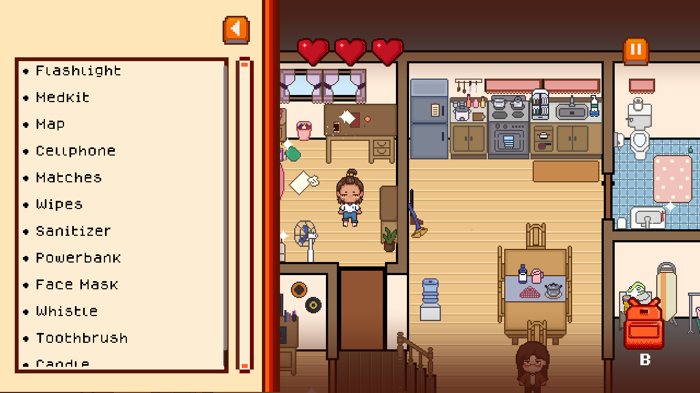
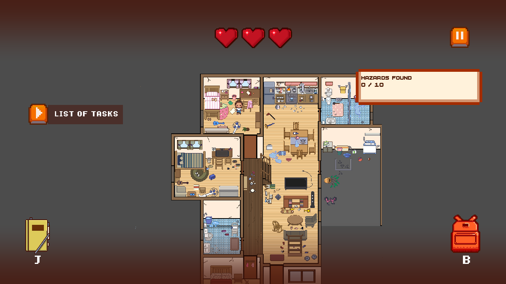
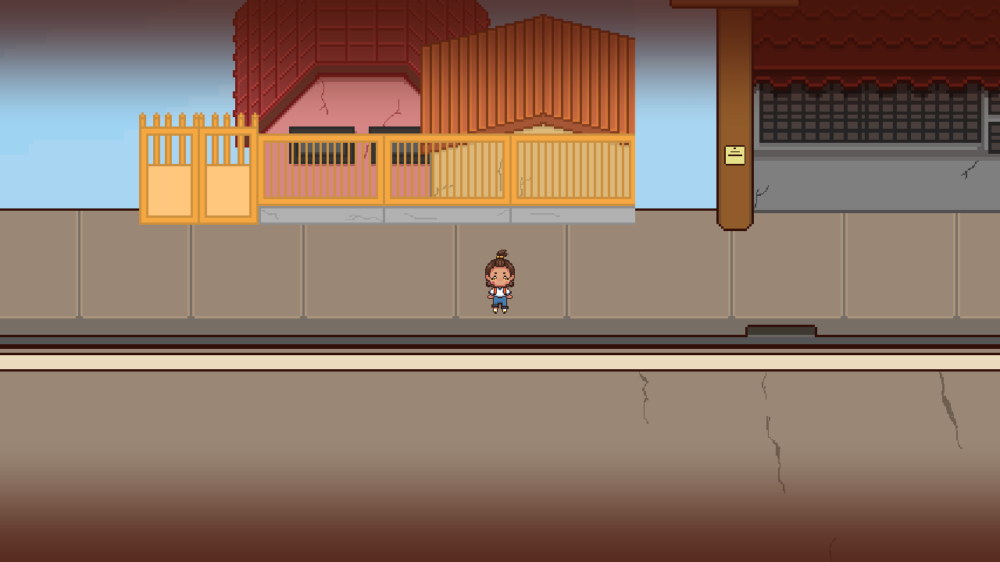
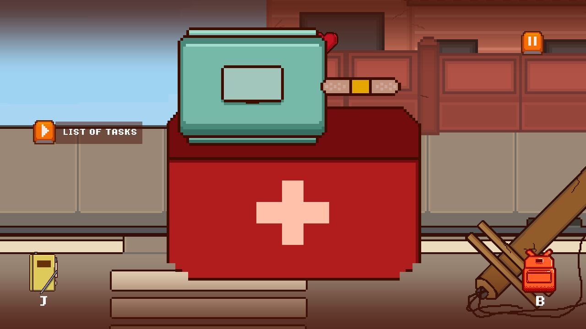
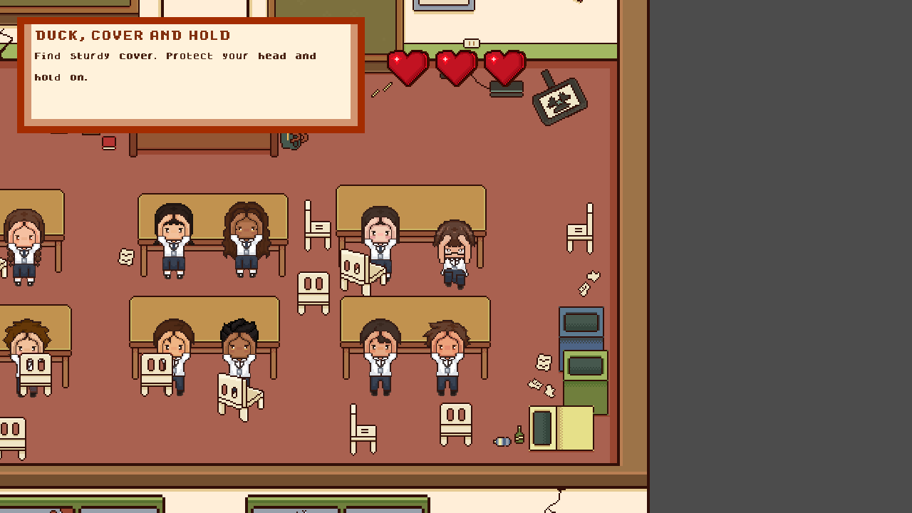
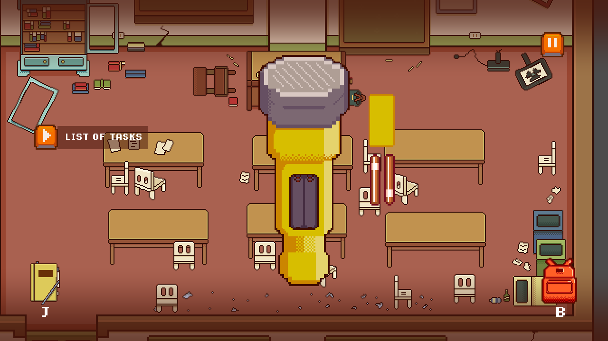
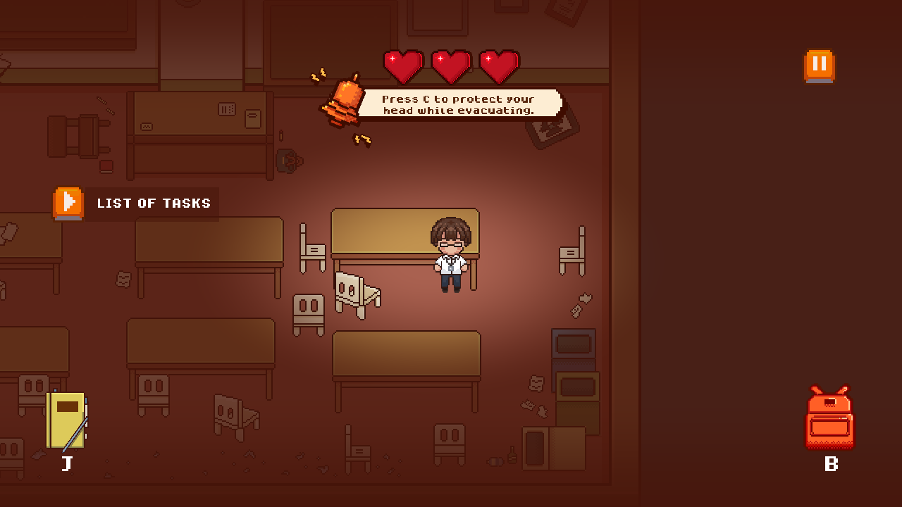
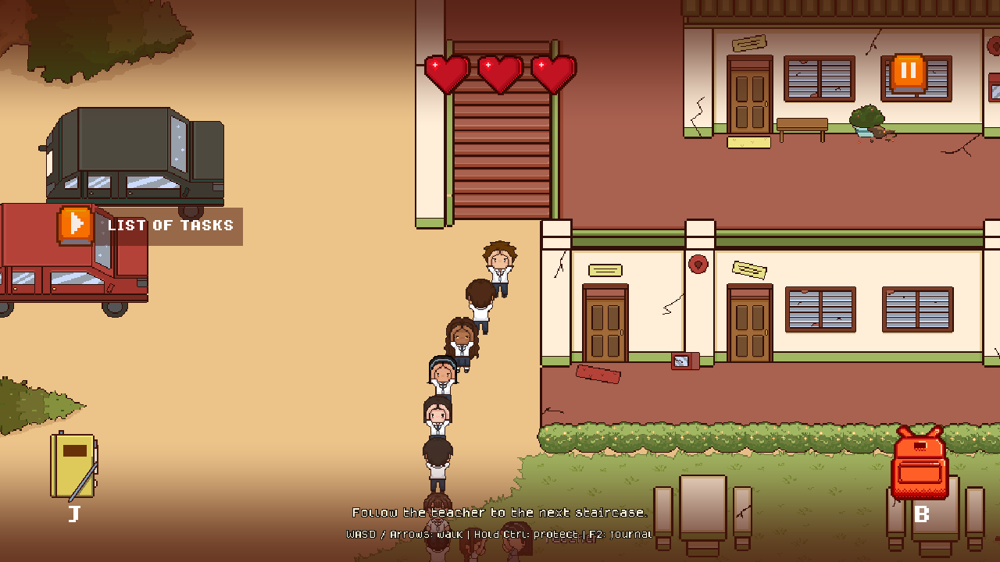
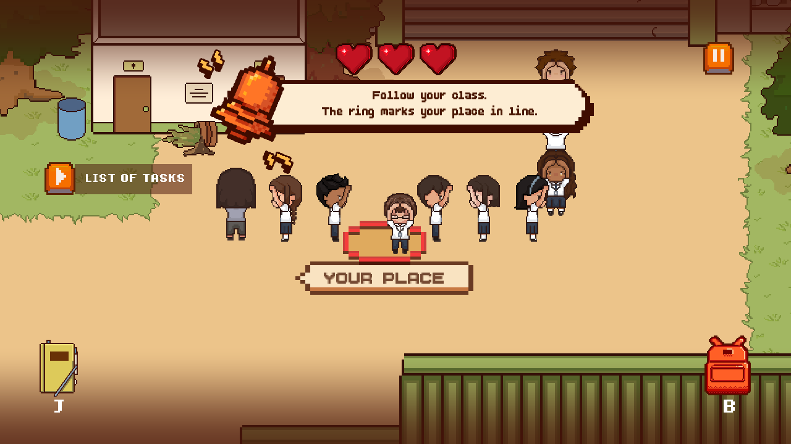
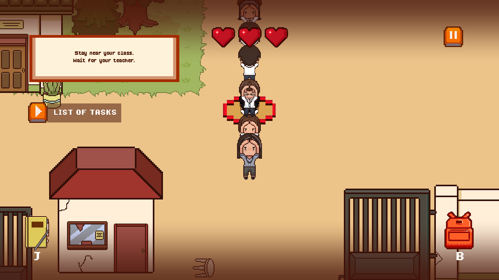

# QuakeScape — Feature Screenshot Collection

Ten screenshots rendered from the current Godot project at 1280 × 720. Selected gameplay states are staged through the capture script to make each feature visible. Captions describe implemented features; these are not AI-generated concept images.

## 01 — Pack for the Unexpected

Search a detailed pixel-art home for emergency essentials. Build your go-bag, track your checklist, and discover which everyday items matter when disaster strikes.

## 02 — Spot the Hidden Hazards

See a familiar home through new eyes after an earthquake. Identify broken objects, fallen furniture, and household hazards before choosing your next move.

## 03 — Navigate a Changed Neighborhood

Make your way through streets transformed by the quake. Watch for falling debris and environmental dangers as you work toward a safer route.

## 04 — Put Your Emergency Kit to Work

Emergency supplies become interactive tools. Use the first-aid sequence to clean and dress an injury, connecting preparation with practical action.

## 05 — Duck, Cover, and Hold

When the classroom starts shaking, every decision counts. Find sturdy cover, protect your head, and hold on through an interactive earthquake response challenge.

## 06 — Bring Light to the Blackout

A sudden blackout turns a familiar classroom into a new challenge. Prepare your flashlight by placing its batteries in an interactive drag-and-drop activity.

## 07 — Protect Yourself on the Way Out

Getting to the exit takes more than moving quickly. Practice protecting your head as Tantan leaves the damaged classroom, with prompts that reinforce safer evacuation habits.

## 08 — Recognize Landslide Danger

Earthquake risks continue beyond the classroom. Follow the class through the school grounds and learn to recognize unstable slopes and landslide danger along the evacuation route.

## 09 — Stay Together, Stay Focused

Evacuation is a team effort. Keep pace with your classmates, maintain your place in the group, and respond to warnings when you drift away from the formation.

## 10 — Wait for the Signal

Reaching the road brings one more decision. Stay with the class, listen to the teacher, and wait for the signal before crossing toward safety.

---

Capture source: `capture_features.gd`. Screenshots use the game's current art and interface. The capture helper lives under `marketing/` and does not change production game scripts or scenes.
