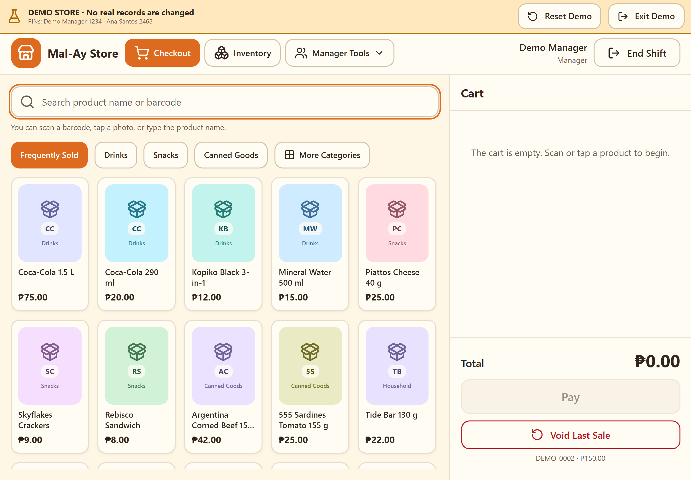
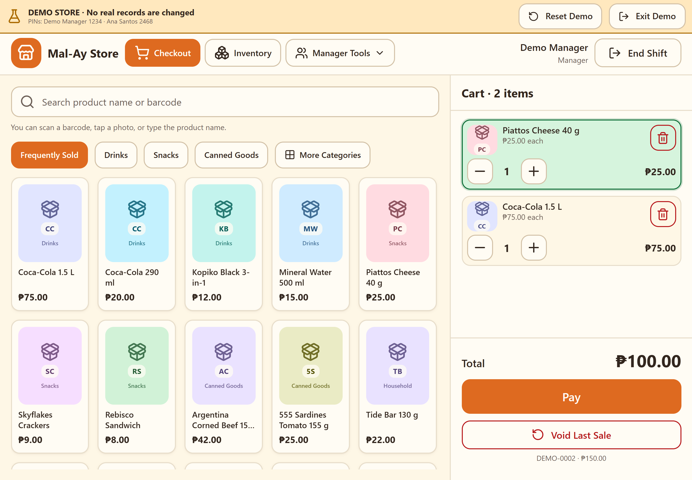
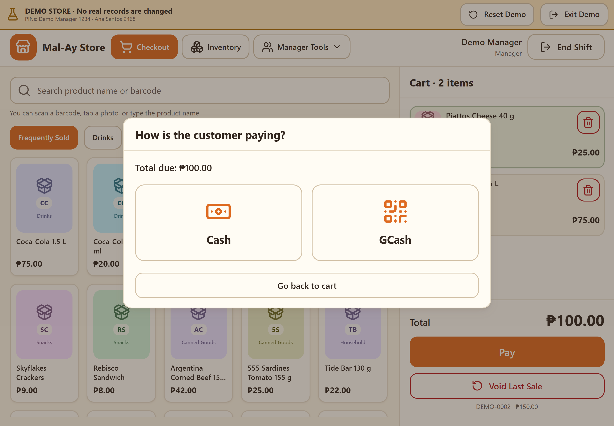
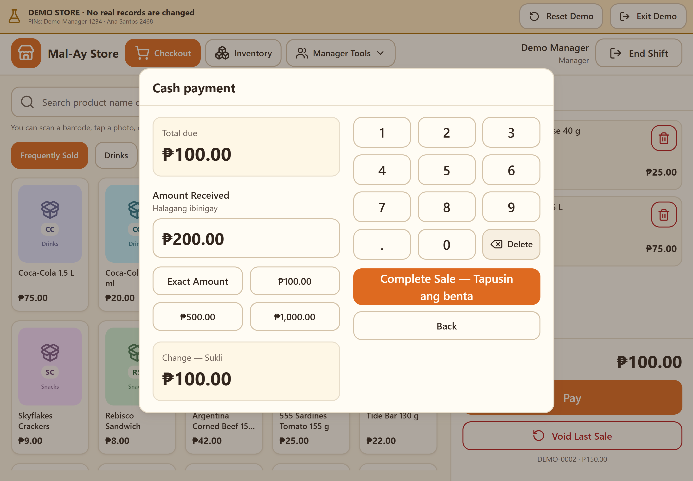
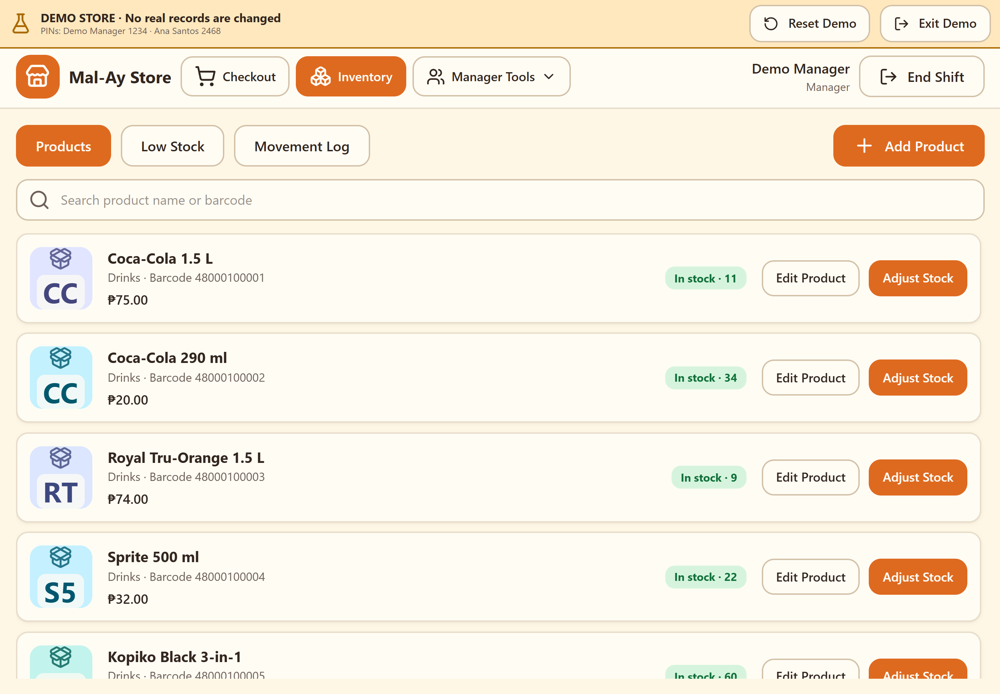
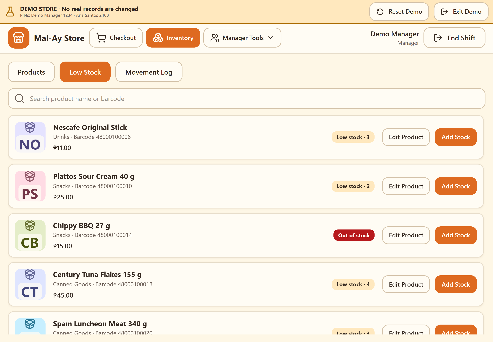
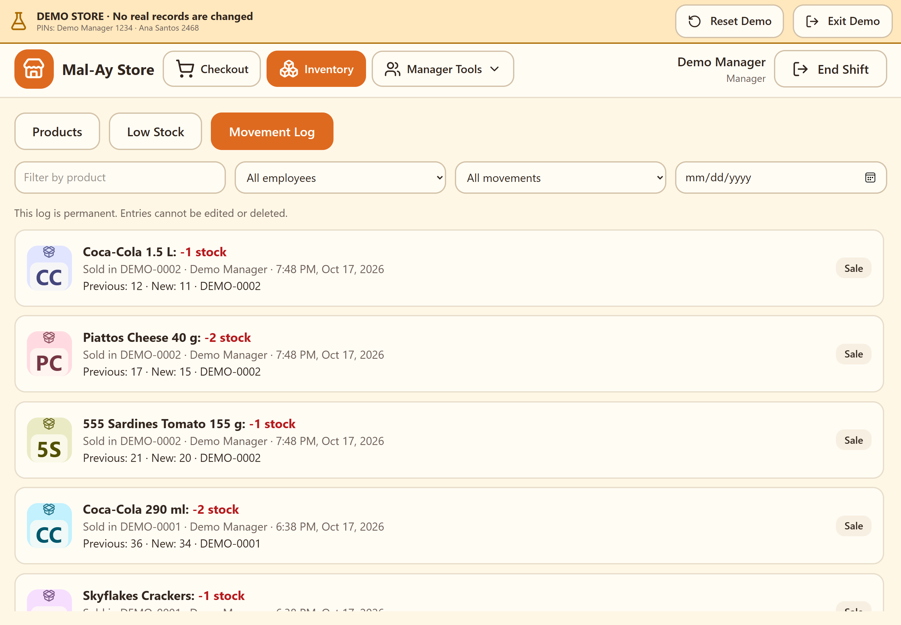
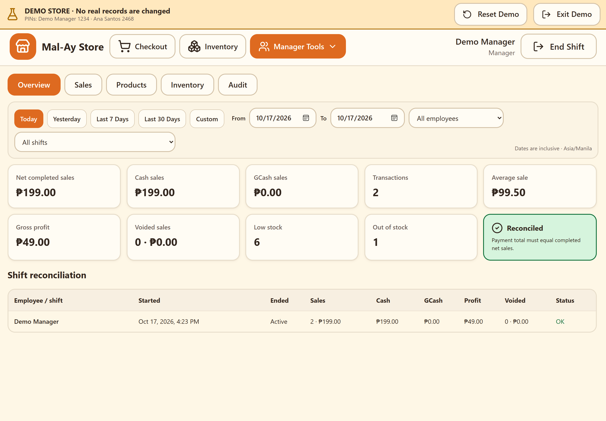
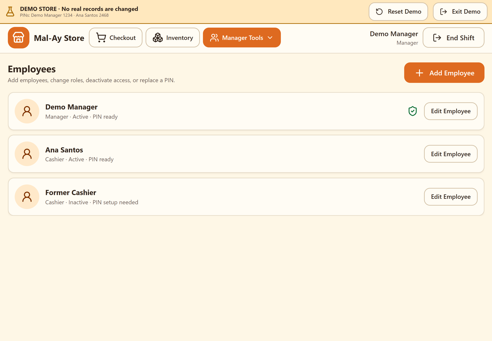
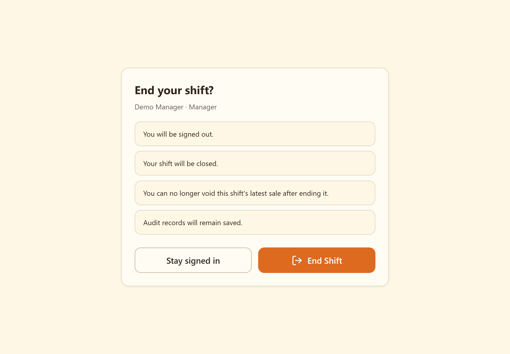

# Mal-Ay Store Assistant — Marketing Screenshots

10 actual application captures, 2880 × 2000 PNG. Sample records are from the isolated demo store. The visible demo banner is retained. GCash is a recorded payment workflow; its QR screen currently uses a placeholder and does not automatically verify payments.

## 01. Everyday selling, made simple

Find products by name or barcode, browse familiar categories, and start a sale from one clear checkout screen.

## 02. See every item. Know every total.

Review quantities, prices, and the running total in a clear cart before taking payment.

## 03. Give customers a choice

Choose Cash or GCash from a straightforward payment screen that keeps the sale total in view.

## 04. Clear totals. Confident change.

Enter the amount received and see the change immediately, with a large keypad and Filipino helper labels.

## 05. Your products, organized

Review product prices and stock levels, edit product details, and adjust inventory from one practical workspace.

## 06. Know what needs restocking

Bring low-stock and out-of-stock products into focus so your next replenishment starts with a clear list.

## 07. Keep stock changes in view

Review a permanent movement history with product, employee, date, and movement-type filters.

## 08. Understand the day’s sales

Review completed sales, payment totals, voids, and stock indicators with date and employee filters.

## 09. Manage your store team

Keep employee access organized with manager and cashier roles and employee PIN controls.

## 10. Finish the shift with clarity

Confirm shift closure with clear reminders about signing out and keeping audit records saved.

