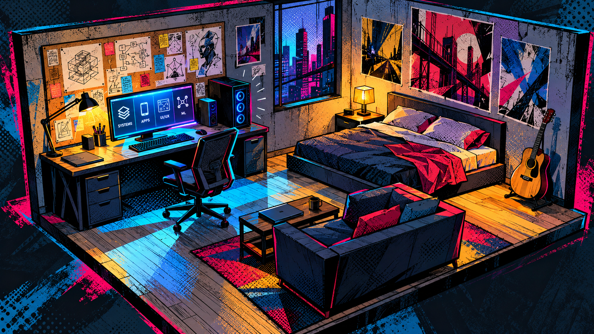

# Comic Room Portfolio — Design and Art Dictionary

Version 1.1 · 13 October 2026 · Desktop prototype first

## Authority and scope

This is the source of truth for the imagined 3D bedroom portfolio and its related interfaces, artwork, models, textures, and animation. Read it before creating or changing those assets.

The user approved concept 2 and rejected concept 1 as too cottagecore. Preserve that decision. Other portfolio codebases can have different art directions; this dictionary applies to the comic-room variant.

Priority: latest explicit user direction → approved concept and this dictionary → reference interpretations → generic design recommendations. Numeric values below are project starting points, not film production measurements. Tune them through visual review.

## North star

An imagined software engineer's room rendered as a dimensional comic illustration: strong silhouettes, striking ink lines, graphic color planes, visible print textures, and deliberate imperfections.

The room must feel spatial when the camera moves and illustrated when the camera stops. The PC showcases Systems, Apps, UI/UX, and Machine Learning. The corkboard introduces the person behind the work.

This concept sets visual energy and composition. It is not proof that the browser renderer can reproduce every detail.

## Fixed decisions

- Imagined bedroom; original identity and layout.
- Cutaway room with an elevated three-quarter starting view.
- Required objects: desk, desktop PC, corkboard, bed, couch, guitar, and desk chair.
- PC and corkboard are the strongest visual anchors.
- Urban comic aesthetic with visible linework and print treatment.
- Cool cyan/blue light against warm amber and selective magenta/red.
- Desktop and mouse interaction first.
- First deliverable: quick feasibility prototype.
- Begin with code-generated geometry; complex modeled assets are optional.
- Keep actual portfolio information readable in web interfaces.

## Visual vocabulary

| Term | Meaning | Project rule |
|---|---|---|
| Dimensional illustration | 3D form combined with drawn marks | Keep perspective and depth; allow flat illustrated details. |
| Graphic reduction | Reduce objects to essential shapes and values | Model recognizable silhouettes first; simplify background details. |
| Ink contour | Drawn silhouette or plane boundary | Vary expressive dark lines; heavier outer edges, lighter internal marks. |
| Internal linework | Marks describing construction, folds, or seams | Use purposeful chair seams, blanket creases, desk joins, guitar details. |
| Ben-Day-style dots | Repeated equal-sized graphic dots | Use on selected flat panels, posters, and printed accents. |
| Halftone | Vary dot sizes to suggest tonal transitions | Articulate shadow boundaries and light falloff; distinguish from uniform dots. |
| Hatching | Parallel strokes suggesting form or value | Follow the object's plane and lighting rather than arbitrary stripes. |
| Cross-hatching | Crossing stroke families | Reserve for selected deep shadows; do not cover every surface. |
| Misregistration | Displaced color and ink layers | Cyan/magenta offsets on selected edges; never distort body text. |
| Graphic shadow | Designed hard-edged shadow shape | Prioritize strong value shapes over soft realistic shading. |
| Cut-paper collage | Flat irregular shapes creating layering | Sparse poster, corkboard, and background accents. |
| Dry-brush marks | Broken paint edges and scratches | Give surfaces authored texture without uniform noise. |
| Atmospheric reduction | Simpler colors and values at a distance | Window scenery and secondary props remain quieter than the PC. |
| Motion lines | Drawn strokes suggesting direction | Brief meaningful transition/feedback accents, never continuous. |
| Smear / echo | Temporary stretch or repeated silhouette | Optional later accent; not required for the prototype. |
| Stepped animation | Hold selected visual poses between updates | Optional decorative effects; camera and controls remain fluid. |
| Kirby crackle | Irregular black clusters suggesting energy | Optional later effect, not default texture. |
| Comic panel | Bounded composition with a focal point | Frame content or transitions while preserving controls. |
| Hand-drawn effects | Authored flat shapes, strokes and held drawings describing energy | Layer illustrated effects into the scene; attach them to a meaningful event. |
| Spatial onomatopoeia | Comic sound words staged as dimensional scene elements | Short bursts have perspective, parallax and occlusion; keep portfolio text separate and readable. |
| Multidimensional fracture | Angular fragments combining distinct camera views and graphic treatments | Briefly mark a world crossing; preserve the continuous underlying camera journey. |

## Shape and composition

Use angular, slightly exaggerated silhouettes and controlled asymmetry. Furniture should feel designed rather than mechanically perfect. Perspective stays coherent.

Starting view:
- Desk and corkboard read as one primary destination.
- Chair does not hide the monitor.
- Couch does not block the desk or conceal the bed.
- Guitar has separation from its background.
- Floor space connects destinations; do not overcrowd the room.
- Window scenery supports the room rather than competing with it.
- Incidental props should express engineering or personal interests.

Hierarchy: PC/corkboard first → bed/couch/guitar second → window/floor/posters third → small props last.

At thumbnail size, fix silhouette, value, and composition before adding detail.

## Color dictionary

Starting palette inspired by approved concept 2:

| Token | Starting value | Role |
|---|---|---|
| ink | #101020 | Outlines and deepest graphic shapes |
| midnight | #151D38 | Backdrop and shadow foundation |
| ultramarine | #3456D9 | Cool ambient planes |
| cyan | #20D5F5 | Monitor spill, selected edges, active accents |
| magenta | #F32B85 | Print offsets and energetic accents |
| red | #ED4054 | Limited fabric/poster contrast |
| amber | #FFB531 | Lamp light and warm planes |
| paper | #F3E7CF | Notes and reading surfaces |
| slate | #66758D | Quiet furniture and walls |

Use named tokens. These are art roles, not automatically accessible foreground/background pairs. Check text contrast separately.

Preserve local colors and quieter planes. Reserve peak saturation and value contrast for focal points. Avoid beige/green dominating the scene. Do not bathe every object in cyan and magenta.

## Line and print rules

At a roughly 1440-pixel-wide overview, begin with outer contours around 2–4 screen pixels and internal marks around 1–2. These are visual tuning targets, not fixed world-unit dimensions.

- Vary line weight; avoid equally heavy outlines around every small mesh.
- Define some surfaces through color boundaries instead of lines.
- Deliberate broken lines are welcome; random per-frame jitter is not.
- Begin selected color offsets around 1–3 screen pixels; keep reading text clean.
- Patterns must be visible in the overview without shimmering during camera movement.
- Prefer stable surface/UV-space marks. Inspect any screen-space treatment in motion.
- A full-screen grain or halftone overlay cannot substitute for material-specific art.
- Leave quiet space between dense patterns.

## Lighting and material dictionary

Screen cyan, lamp amber, ambient blue: a few strong relationships, designed hard shadow shapes, and readable depth. Start with two to four tonal regions on major surfaces; allow some elements to remain flatter.

| Object/surface | Treatment |
|---|---|
| Walls | Broad muted planes; selected scratches and patches; quiet regions between posters |
| Desk | Angular planes, drawn joins/scuffs, hard cyan/amber shapes |
| PC tower | Dark silhouette, flat accents, restrained glow, ink edges |
| Monitor | Bright focal surface, clean content, illustrated casing |
| Corkboard | Warm simplified base, clear paper silhouettes, pins and purposeful diagrams |
| Chair | Strong contour, planar seat, selected seams/mesh suggestion |
| Bed | Large blocked folds; selected hatching and halftone shadows |
| Couch | Chunky cushions, ink seams, limited pattern regions |
| Guitar | Recognizable body/neck, drawn strings and rim, warm local color |
| Floor | Broad planes/planks, graphic shadows, sparse linear marks |
| Window/city | Simplified silhouettes/rectangles; reduced detail and contrast |
| Posters | Original graphic art and collage; no reliance on franchise logos |

No photorealistic material pack should dictate the look. Keep highlights authored and restrained. Glow must not erase contours or wash out content.

## Interface and typography

The room is expressive; the information is clear.

- PC categories: Systems, Apps, UI/UX, ML.
- Case studies explain problem, contribution, decisions, evidence, and outcome.
- Never invent projects or achievements; label prototype entries as samples.
- Use real selectable text for descriptions, links, and controls.
- Short headings/object labels can use comic captions. Paragraphs use a readable sans.
- Proposed type roles: bold condensed display, readable sans body, mono technical labels. Exact families remain undecided.
- Starting body size: 16–18 px; line-height around 1.5–1.65.
- Panels: sharp borders, offset solid shadows, restrained print accents.
- Avoid glossy glass panels and generic rounded SaaS cards.
- No channel splitting, distortion, or dot texture over body text.
- Keep Projects, About, Contact directly reachable with keyboard-accessible equivalents to scene objects.
- Hover and focus reveal the same object name and purpose.
- Selection is indicated beyond color alone.
- Return-to-room control stays obvious and accessible.

## Interaction and motion

Journey: overview → object feedback → intentional camera move → readable content → return.

Prototype starting timings: hover/focus 120–200 ms; camera 650–950 ms; content arrival 180–300 ms. Tune through use; these are not film-derived rules.

Camera paths preserve spatial continuity and avoid furniture. Allow interruption/return without queuing repeated clicks. No mandatory cinematic intro.

Use brief emphasis marks for meaningful feedback. No constant glitching, strobing, camera shake, or permanent motion lines. Sound is optional and starts only when enabled.

Animating on twos is a decorative possibility, not a reason to reduce the entire website's frame rate. Camera, controls, and reading interactions remain responsive. Reduced-motion removes decorative animation and uses direct or brief destination changes.

## Explicit anti-direction

Reject:
- Cottagecore, hanging vines, floral textiles, ornate rugs, decor-led clutter.
- Beige/cozy lifestyle mood as the dominant identity.
- Smooth glossy miniature rendering with a comic filter added afterward.
- Photorealistic furniture and soft gradients everywhere.
- Equal contrast, saturation, line weight, and pattern density across all objects.
- Chromatic aberration on readable text.
- Generic neon gaming-room styling replacing illustration.
- Constant multiverse chaos that prevents information discovery.
- Mixing every Spider-Verse universe's style without a deliberate reason.
- Conventional landing-page sections replacing the room.

Personal comfort is allowed. The visual language must remain bold, graphic, urban, and visibly illustrated.

## Feasibility prototype contract

One room composition with all required object silhouettes. Prioritize desk, PC, and corkboard materials. Implement a PC camera transition and sample portfolio interface plus a simple corkboard introduction. Secondary furniture may be simpler.

Establish silhouette → graphic lighting → contours → patterns → selective accents. Test treatments on a desk-and-wall scene before polishing every prop.

Desktop first. Record observed loading/frame behavior and testing context rather than claiming unmeasured performance. Mobile optimization, intricate models, sound, extra worlds, and full content follow later.

The concept sets the target. Actual browser renders establish feasibility.

## Acceptance checklist

- At thumbnail size the desk/corkboard read as the destination.
- All required objects are identifiable.
- Linework, graphic shadows, and print patterns are visible without zooming.
- At least three techniques contribute distinctly: contours, halftone, hatching, color offsets, or collage.
- Some surfaces are quiet; pattern density is not uniform.
- Depth remains convincing during camera movement.
- Surface marks remain stable without crawling/flickering.
- PC content stays readable and undistorted.
- Interaction feedback and return path are clear.
- Keyboard navigation and reduced-motion work.
- Hand-drawn effects originate from the action and clear when it ends; spatial sound words obey perspective and depth.
- Multidimensional fractures have intentional alternate views and treatments; the scene reassembles into a coherent destination.
- Effects never fracture reading text or controls, and skip/return cancels every transient layer.
- The render aligns with concept 2 and does not drift toward rejected concept 1.

Fix composition, shapes, lighting, or materials before adding effects to a failing view.

## References and traceability

Timestamp notes paraphrase user-provided transcripts. Transcription errors exist; terminology is normalized. These sources establish visual principles, not exact browser shader algorithms.

### T1 — First video, style/animation analysis
[Video](https://www.youtube.com/watch?v=q86tPSkGmgs) · [Transcript](references/video-1-transcript.txt)

- 2:02–2:35: art style and animation style are distinct decisions.
- 2:42–6:26: 3D base with drawn treatment; individual frames as artwork.
- 6:35–7:42: selected stepped animation and dimensional linework.
- 8:57–9:27: lines express movement and direct attention.
- 9:45–13:53: captions, uniform dots, halftone, hatching, panels, color separation.
- 13:53–15:22: graphic reduction preserves recognition while simplifying detail.
- 17:28–18:47: emphasis and lighting vary by context.
- 29:02–30:04: strong silhouettes and value planning carry limited-color scenes.
- 37:48–40:02: context-specific panels and burst cards.
- 40:02–44:43: glitch intensity follows narrative need; our use stays selective.

### T2 — Illustration Masterclass: The Art of The Spiderverse
[Adobe Live video with Kyle T. Webster](https://www.youtube.com/watch?v=3EvuqiNUDDs) · [Transcript](references/video-2-transcript.txt)

- 2:15–3:03: flat line/shapes coexist with shaded dimensional form.
- 3:03–4:28: patterns, splatter, collage, and different pattern scales.
- 4:34–6:08: selective lines describe planes over rendered forms.
- 6:08–7:17: print offsets and bright color echoes.
- 9:49–11:02: simplified graphic silhouettes within dimensional environments.
- 11:08–12:22: halftone for shadow transitions, background reduction, light falloff.
- 13:57–15:23: reduced background color and selective outlines protect focus.
- 15:30–17:25: paint and drawing can deliberately break neat boundaries.
- 17:31–19:37: direction lines and silhouette echoes communicate energy.
- 20:20 onward: custom-brush demonstration. Borrow visual outcomes; Photoshop and those brushes are not required.

### R1 — Yuhki Demers environment artwork
[Artist's Spider-Verse gallery](https://www.yuhkidemers.com/spiderverse)

- [Dorm room](https://images.squarespace-cdn.com/content/v1/55cb8838e4b0c0f75a3f9e80/1568823979565-BWBRVY3YFLDA6QZOAP9H/env_dorm_02d_ydemers.jpg): personal objects and environmental storytelling.
- [Desk](https://images.squarespace-cdn.com/content/v1/55cb8838e4b0c0f75a3f9e80/1568826504426-NWVFGI1NE1WXRNVTWYMD/artstaysh_desk_02g.jpg): workspace composition and detail hierarchy.
- [Uncle Aaron interior](https://images.squarespace-cdn.com/content/v1/55cb8838e4b0c0f75a3f9e80/1568835062028-725Y98BBUZNFCVDQYLV3/artstation_uncleaaron_interior_color_01g.jpg): alternate interior atmosphere.

### R2 — Supplemental room reference
[Dave Bleich dorm-room artwork post](https://x.com/dbleich/status/1090265220902076421). Post access is limited; do not base unverified production claims on it.

### R3 — User-shared techniques article
[Spider-man Into the Spider-verse — a balance between art and technology](https://medium.com/everythingcg/spider-man-into-the-spider-verse-a-balance-between-art-and-technology-e7b88aab2a56)

Supporting discussion of hand-drawn/3D combinations, halftone, hatching, and print misregistration.

### A1 — Approved original concept
[Concept 2](references/approved-room-concept-v2.png), generated with the built-in image tool and explicitly approved by the user. Immediate visual benchmark.

## Reusable art brief

Original cutaway software engineer bedroom as a dimensional comic illustration. Elevated three-quarter view; desk, PC, corkboard, bed, couch, guitar, chair. PC/corkboard dominate. Angular expressive silhouettes, bold varied ink contours, lighter internal marks, hard graphic shadows, variable halftone, selective hatching, cyan/magenta misregistration, sparse collage/dry-brush marks. Midnight blue environment, cyan monitor, amber desk lamp, limited magenta/red. Surface-specific texture; quieter secondary areas. No cottagecore decor, photorealism, glossy miniature rendering, uniform noise filter, or distorted reading text. Preserve depth and readable portfolio content.

## Direction update — scroll story and character (latest user instruction)

The portfolio is now planned as a scroll-driven comic story about Steven Joe Valdez. The bedroom is one chapter, not the whole experience. The user explicitly requested a fictionalized unmasked Spider-Man version of himself, using his supplied face photo as a reference.

This supersedes earlier restraint about franchise motifs, introductory sequences, quiet background density, and keeping the room as the entire main experience. Use a full-screen scene without a traditional top navbar. Add deliberate maximalism: layered dimensional backdrops, color fields, comic bursts, graphic fragments, character presence, and fast movement followed by dramatic extended holds.

Preserve focal hierarchy and readable information. Effects should support chapter transitions and story beats. Avoid uncontrolled strobing. Scrolling must be reversible; reduced-motion mode presents readable chapters and a stable character.

Character study 01 lives at designs/comic-room/character.html. Its procedural model is an early shape/pose study, not an approved final likeness or a skinned production rig. Keep the uncovered face and swept dark hair. Black/red suit is the current interpretation; the exact costume and proportions remain refinable. Do not add fabricated autobiographical events or achievements.

The proposed sequence is: introduce Steven → reveal curiosity → enter the working world → take the leap → explore project worlds → invite the next collaboration. Real biographical copy and full chapter integration remain future work.

## Current focus — room and surrounding world

The user set aside the character study after rejecting its visual quality. Continue work on the main room page. Do not present character study 02 as an approved likeness or integrate it into the room without new user direction.

The latest room pass uses a full-viewport composition, closer camera, no traditional navbar/footer/hero, and layered comic collage around the room: large color fields, halftone, dimensional rings, floating systems/interface/music/code sketches, and edge ink marks. Object interactions remain primary; a small Room Map provides accessible section navigation.

Keep the room dominant. Surrounding shapes should frame it, while transition effects can temporarily converge on the selected destination. Disable decorative drift for reduced-motion visitors.

## Room motion vocabulary — implemented pass

- Hold floating comic artwork at 12 decorative poses per second; keep the camera, pointer interaction, and rendering smooth.
- Use slow ring tilts and sparse ink clusters at the outer edges to give the surrounding world depth. Keep the room silhouette and text readable.
- Draw short object emphasis marks on hover. They indicate interactive objects; they do not pulse continuously.
- Camera travel launches quickly and settles slowly using cubic-bezier(0.23, 1, 0.32, 1). A 500ms edge speed-line accent accompanies the existing 850ms spatial transition.
- Pause Motion freezes the decorative clock and ray field while navigation remains available. Respect live changes to prefers-reduced-motion: stabilize decoration, omit travel accents, and navigate immediately.
- Cancel old travel effects when a new destination, reset, or return interrupts them.

These are browser adaptations of production principles. Sony's discussion of animation on twos informs held decorative poses; it does not imply that the entire browser runs at 12fps. SideFX's production interview informs the layered ink clusters and graphic effects.

Sources: [Sony Pictures Imageworks](https://www.imageworks.com/node/1371), [SideFX production interview](https://www.sidefx.com/community/spider-man-into-the-spider-verse/).

## PC interaction — usable desktop

The PC now hosts WORLD_OS within its monitor. Clicking it moves to a close, straight-on screen view and enables native mouse/keyboard folder interaction. Do not open an external portfolio dialog for the PC. Keep the monitor casing visible so the visitor remains inside the room.

Folders organize Systems, Apps, UI/UX and ML. Project files open in an explorer window within the monitor, with search, sidebar navigation, draggable title bar, minimize/close, and taskbar restore. Preserve readable text and familiar desktop controls within the comic visual language. Leave desk and Escape return to the room; restore keyboard focus to the originating control. Real project content still needs to replace labeled demo files.

## Corkboard interaction — whole board in the room

Clicking the corkboard brings the camera closer to the entire board. Raise the viewing angle enough to keep the monitor from obscuring its lower notes. Do not open an About popup. The pinned papers carry the introduction and visual work/design map, while the physical cork, ink frame, pins and surrounding desk stay visible.

Use the supplied name Steven Joe Valdez and software engineer role. Keep unwritten biographical information explicitly marked as placeholder content. Back to room and Escape return to the room and restore focus. Expose the same note text to assistive technology and as a readable native fallback when 3D is unavailable.

## Couch interaction — hidden wormhole

Pull Up a Seat is now a story event. Lift and peel the physical couch seat cover upward, expose a cyan/magenta/amber wormhole, carry the camera into it, travel through angular ink-edged tunnel rings, and settle into a separate floating city/platform world. Contact information appears only at the destination; do not open the old contact popup.

The prototype journey lasts about 4.8 seconds: reveal and short hold (0–1.45s), dive (1.45–2.2s), fast-to-slow tunnel travel (2.2–4.8s), then stable readable contact. Use the existing cinematic ease-out curve. Keep Skip to contact and Back to room available during travel. Escape cancels any phase, resets the couch and restores focus. Reduced motion and the native no-WebGL fallback navigate directly to contact.

Only use the supplied contact details: valdez.stevenjoe@gmail.com; https://github.com/stvsky20; https://www.linkedin.com/in/steven-joe-valdez-15817128a. Contact links are real; do not fabricate extra accounts.

Mood reference supplied by the user: [Sunflower — Post Malone and Swae Lee](https://www.youtube.com/watch?v=ApXoWvfEYVU). Its identity was verified; video footage was not accessible to the web tool. This sequence is an original interpretation of the established comic vocabulary, rather than a recreated film shot.

## Destination update — graffiti subway

The user selected the abandoned subway/graffiti direction for the couch portal. This replaces the floating city contact destination. Preserve the couch lift and wormhole travel; arrive at an empty subway platform with tracks, tiled walls, original graffiti, industrial columns/beams, fluorescent lights and a bench.

Make the station recognizable before contact appears: hold the arrival view for one second, then reveal email and social links as signage mounted on the station wall. Use an original LET'S BUILD SOMETHING mural as the creative focal point. Preserve contact readability, direct native link interaction, skip/return controls, cancellation, reduced-motion and no-WebGL fallback.

Production reference: [Wardenlight Studio's subway concepts](https://wardenlight.artstation.com/projects/oObGrB). This is an original environment based on that location's visual vocabulary, not an exact surveyed New York station. Reserve the proposed skyline/rooftop journey for clicking the bedroom window in a future pass.

## Arrival choreography — train wipe

A three-car subway train passes across the view at the tunnel exit, briefly hiding the destination. Begin the crossing at 4.0s, switch from the tunnel to the platform while the train fills the view at 4.8s, clear the train at 5.6s, then reveal contact after a 600ms platform hold. The train uses linear travel along the rails, graphic silver bodies, ink contours, opaque windows, doors and cyan/magenta stripes.

Keep contact hidden until the final carriage has cleared. Skip and reduced-motion modes bypass the train; return/cancel resets it. This supersedes the previous one-second arrival hold and adds a deliberate visual bridge between tunnel travel and station arrival.

## Timing refinement — train follows the camera glide

Supersede the independent 4.0s/4.8s/5.6s train timing above. Drive camera movement and train crossing from one normalized 2.6-second tunnel glide. Start the train at 30% of the glide (2.98s overall), conceal the tunnel-to-platform cut at 65% (3.89s), and clear the train as the camera finishes at 100% (4.8s). Reveal contact after a short 300ms settling beat.

Use cubic-bezier(0.77, 0, 0.175, 1) for the tunnel camera so it continues moving through the wipe. Keep train translation linear within its crossing interval. Do not snap the camera to the arrival pose at the scene cut: continue the same glide to its final position. Skip, reduced motion and cancellation still bypass/reset the sequence.

## Smear frames and selective held poses

Use drawn speed streaks and offset cyan/magenta contour echoes to describe fast movement. The train's illustration accents now hold at 12 poses per second; native rendering, camera glide and train translation retain the synchronized travel timeline. This adapts the illustrated principle without treating lower browser FPS as an art style.

Keep graphic smears brief and specific to the moving object. Do not blur contact text, distort the entire viewport, or leave echoes on the settled platform. Pause Motion removes these decorative accents; reduced motion bypasses the train. Skip and return reset them.

Verified production source: [Sony Pictures Imageworks](https://www.imageworks.com/node/1371), describing animation on twos, smearing geometry, speed lines, and multiple limbs instead of traditional motion blur. The user supplied https://www.youtube.com/watch?v=9jH0wDp5GnQ; that video could not be fetched, so its exact wording was not verified.

## Train staging — enter from a physical track tunnel

Do not show the train materializing in open space during the camera approach. Dark track tunnel casings, foreground retaining walls and ink-edged jambs now hide the offstage carriages. Fixed world-space clipping boundaries at the mouths also contain the train's bodies, windows, outlines and smear strokes. All passing-train materials must use these boundaries.

Keep the established shared camera/train timeline. The geometry explains the entrance; do not solve it with an unexplained visibility pop or a new timing delay. The station remains unobstructed from the final contact view.

## Portal entrance — spatially continuous passage

Replace the flat spiral-to-tunnel view reset with a live view into the wormhole on the couch surface. Keep graphic spiral color on the edge, while the interior shows the actual tunnel. Match the narrow elliptical opening with dimensional collar rings that expand into the tunnel.

Use a curved approach and map the camera's entrance-relative position and orientation into the destination when it crosses the portal plane. Preserve that pose at the rendering handoff; start the main glide from the approach endpoint. Keep the shared train timing and all skip/return/reduced-motion behavior. Only render the extra portal view while approaching from outside.

## Wormhole enclosure — dimensional comic panels

Enclose the portal passage with opaque faceted walls. The shell begins at the narrow elliptical couch aperture, expands alongside the entrance collar, and follows the twisted rings to the tunnel exit. Side views must hit the lining rather than expose empty exterior space.

Use flat blue/violet value panels, deep ink seams, selective halftone and hatching; retain cyan/magenta/amber rings as high-contrast accents. Avoid glass, translucent walls, glossy sci-fi materials or photorealistic lighting. Keep the axial exit open toward the subway. Hide the entire lining with the existing tunnel group during the train wipe, preserving camera continuity and navigation behavior.

## Approved effects expansion — hand-drawn effects and onomatopoeia

Approved by the user on 13 October 2026. These are rules for future effect passes; this dictionary update does not imply that the effects are already implemented.

Treat energy as drawn artwork inside a dimensional scene. Use original irregular ink strokes, jagged electrical branches, cut-paper flashes, expanding impact shapes, smoke curls and selective Kirby crackle. Fire, explosions and electrical hits belong to actions that justify them; do not scatter them through the bedroom solely to increase density. Build them from authored sprite sequences, vector drawings, textured planes or code-generated illustrated geometry. A particle system can place those drawings, but smooth glowing particles alone do not establish the treatment.

Stage effects in world space: anchor them to the emitting object, orient their flow to the action, and let foreground objects occlude them. Layer a flat drawing with dimensional geometry when it adds depth. Use hard color regions, variable ink weight and held drawings, with brief smear/echo frames at peaks. Avoid realistic fire simulation, soft motion blur and uniform procedural noise as the defining look.

Comic sound words are physical graphic accents. Use short original lettering such as FWIP for the cover release, WHOOSH for portal travel or KRAK for an energy fracture. POW and KABOOM require an actual impact or explosion beat. Place lettering on ink-edged burst shapes or shallow dimensional letter geometry; allow a small rotation, foreshortening, parallax and depth occlusion. Camera-facing lettering is acceptable when its position and scale still belong to the scene. Do not implement every burst as a fixed viewport sticker.

Starting choreography: anticipation stroke → snapped impact drawing/word → brief readable hold → trailing smear or shape breakup → clear. Begin short accents around 150–450ms, extending a hold only when the story needs it. These are project tuning values, not film measurements. A dramatic slow beat can retain one strong composition while fast marks finish around it. Visual sound words do not require audio.

Prioritize the existing story: couch cover release, portal ignition, entry into the wormhole, and the passing train. Keep accent staging subordinate to the continuous camera route and synchronized train wipe. Clear bursts before the settled PC, corkboard or contact reading view. Maintain original artwork and lettering rather than depending on extracted movie assets.

## Approved effects expansion — multidimensional glitching

Use a cubist fracture to communicate crossing between visual worlds. Break selected scene imagery into designed angular cells that briefly show different viewpoints and graphic treatments, then reassemble into the destination. Ordinary RGB separation remains print misregistration; it does not by itself fulfill this multiview effect.

For a faithful browser adaptation, render a small number of alternate cameras into textures and combine them through an angular mask. Start with two or three views, with deliberate offsets in angle or perspective and distinct treatments: cyan ink/hatching, magenta silhouette planes, or amber halftone. Keep an identifiable subject or spatial anchor across the pieces. Fragments should feel like conflicting views of one moment, rather than unrelated images or random screen corruption.

The strongest proposed trigger is the wormhole threshold: a brief fracture at entry or the world boundary, followed by a clear, enclosed tunnel and recognizable subway. Use a localized object fracture for another meaningful story beat only when its purpose is clear. Do not introduce an alternate-universe character until the user approves that character direction. Preserve the real camera position, orientation and shared train timeline beneath the composite; effect cameras must not cause a navigation jump.

Starting choreography: coherent image → short staggered angular split → contrasting held views → deliberate alignment → clean image. Begin around 200–500ms for a transition accent. Avoid continuous jitter, full-screen flashing, unreadable kaleidoscopes and permanent fractured scenery. Use displaced edges, brief pose holds and graphic cuts instead of rapid light/dark strobing.

Budget the extra rendering explicitly. Render alternate views only while the event is active, cap render-target sizes, and measure the cost alongside the existing live portal view. Prefer localized masks and fewer views before adding more passes. A lighter geometry-slice or pre-authored collage fallback is allowed; describe it as a stylized approximation rather than claiming it renders multiple camera angles. Dispose or reuse temporary render targets and remove transient fragments after cancellation or completion.

## Shared rules for the new effects

- Keep native portfolio descriptions, project controls, contact links and navigation outside distortion masks. Decorative lettering cannot replace essential instructions or labels.
- Preserve focal hierarchy during maximalist peaks: one dominant action, supporting marks, and an intentional quiet reading beat afterward.
- Pause Motion freezes or removes decorative drawings and fracture layers while navigation remains usable. Reduced motion omits fragment displacement and rapid bursts, using a stable illustration or brief fade with a direct destination change.
- Skip, Escape, return and interrupted navigation cancel effects immediately and restore a coherent scene. Effects must not restart unexpectedly after returning to the room.
- Verify perspective, occlusion and legibility from the moving camera, including entrance and exit frames. Verify that no effect exposes the wormhole exterior or undermines the physical train entrance.

Production grounding: [Sony Pictures Imageworks' Spider-Verse breakdown](https://www.imageworks.com/node/1371) describes hand-drawn effects alongside 3D, comic sound effects, and multidimensional glitching assembled from differently treated camera renders through a screen-space cell pattern. [SideFX's production interview](https://www.sidefx.com/community/spider-man-into-the-spider-verse/) supports the layered 2D/3D effects approach. Our event mapping, world-space lettering, palette, durations and browser budgets are project decisions inspired by those principles, not claims about exact film production settings.

## Couch affordance — a peek at the hidden passage

Hovering the physical couch or its Pull Up a Seat label lifts the existing cover slightly (about 14 degrees) and exposes a narrow glimpse of the live wormhole. Use a reversible 180ms lift with the existing strong ease-out curve. Leaving closes the cover; clicking continues from its current pose into the full opening without a reset or snap. Keep the portal clickable through the revealed gap.

Keyboard focus on the contact destination shows the same pose immediately. Fine-pointer hover gating prevents touch-generated hover; reduced motion and Pause Motion use a static hint. Only show this preview while the room is available for interaction. Return from the subway restores the enclosed tunnel for the next preview; navigation away clears the hint. The camera stays in the room during the preview.

## v1.1 application 01 — couch release and world crossing

The first effects pass is implemented in designs/comic-room/src/portal-fx.js. A world-space FWIP burst appears beside the lifting cover for 460ms. Six depth-tested illustrated electrical cards use three original drawn poses held at 12 updates per second around the portal during ignition. A world-space WHOOSH burst appears briefly inside the tunnel at the crossing. All lettering retains perspective and scene occlusion; none replaces portfolio information.

At the actual camera crossing, a single 440ms fracture composites two real alternate-camera renders into skewed triangular cells. The views have small opposing position/angle offsets and receive cyan halftone or magenta hatch/value treatments. The center retains a recognizable path through the enclosed tunnel. The underlying camera and synchronized train timeline continue unchanged. Extra views render only while the fracture is visible, using reusable targets capped at 768px width; no additional passes run on the settled platform.

Pause Motion is now accessible within the journey navigation. Pause removes the new accents while navigation continues; skip, cancellation and reduced motion clear/bypass them. The next preview restores the tunnel lining. Browser checks cover the physical lettering/energy, actual alternate renders and target bounds, effect cleanup, pause, cancellation, reduced motion, the existing train choreography and portal camera continuity. Performance depends on the device; the target cap is a rendering budget, not a measured FPS guarantee.

## Portal refinement — continuous surface linework

The user requested smoother integration because the lines appeared pasted into the wormhole. This supersedes the independently rotating internal rings and longitudinal line objects: colored bands and tapered trails are now drawn in the opaque lining's UV space. They follow the same faceted geometry, twist, perspective and depth as the printed panels. Small adjacent pigment fields connect each narrow contour to the wall; antialiased boundaries keep it readable in motion. Preserve the dimensional comic treatment without detached wire hoops or a glossy lighting effect.

At the couch mouth, replace the six camera-facing electrical cards with curved ink-edged strokes rooted around the elliptical aperture. Their orientation stays attached to the rim as the camera approaches; opacity eases into and out of the ignition beat. The spatial FWIP/WHOOSH lettering and brief multiview fracture remain. Pause, reduced motion, cancellation, the continuous camera crossing and synchronized train wipe retain their existing behavior.

## Portal exit correction — leave the passage physically

The user observed the tunnel disappearing while its edges were visible. Supersede the fixed shell removal at 65% of the train glide. The shell now widens into a physical exit over its final ten world units and ends at z=-72, before the camera settles at z=-75. Continue rendering it throughout the approach and train phase; remove it only once the entire shell is behind the camera's near plane. The widening opening reveals the station naturally as the camera advances.

Keep the train's shared glide timing and contact settling beat. The train phase now identifies choreography rather than triggering a tunnel visibility cut. Skip and reduced motion may still navigate directly to the destination; return restores the complete passage. Regression checks sample the journey to reject early shell removal and confirm that the shell intersects none of 25 final-view rays.

## Return choreography — replay the passage backward

Back to Room from the settled subway replays the 4.8-second journey in reverse. Hide contact, move the train along its existing clipped track in the opposite direction, retreat through the same flared tunnel, replay the threshold fracture and spatial accents backward, map the camera back across the couch aperture, and close the cover while retreating to the entry viewpoint. Sample one shared camera/cover timeline in both directions; do not maintain a separate approximate return route.

Compute the aperture crossing from the same path and near-plane threshold so frame timing does not change the transition. The tunnel visibility follows camera position in both directions: restore it while its exit is still outside the visible frustum, and retain it during the backward glide. Ease the room approach orientation from the saved entry orientation to avoid an opening/closing camera snap. Decorative wall flow reverses during return and honors Pause Motion.

Skip to Room and Escape cancel the return immediately. Back during an unfinished outbound journey remains an immediate cancellation. Reduced motion and no-WebGL use a direct return; a live reduced-motion change also ends the reverse journey. Repeated return clicks cannot restart it. Restore the originating section control's keyboard focus when the room becomes usable again. Browser checks cover the full reverse timeline, reverse train direction, threshold effects, cover closing, room crossing, focus, skip, Escape and live reduced motion.

## Window chapter — leap-of-faith rooftop

Approved by the user on 13 October 2026. Clicking the window or its Take the Leap label enters a separate 3D rooftop/city chapter. The window's bars slide aside and its surface previews the actual city before the camera approaches, rises alongside the tower, and settles at a physical ledge. Hold the rooftop view until the visitor chooses Take the Leap; then accelerate into the fall, slow the descent while rolling the camera, and hold the inverted city composition. Replay returns to the ledge; Back to Room/Escape restores the room and originating focus. Keep native skip and motion controls available.

Reference: [leap-of-faith film still](references/leap-of-faith-shot-reference.jpg), from https://images.everyeye.it/img-notizie/spider-man-universo-miles-morales-supereroe-clip-v3-355338.jpg. Match its blue-violet atmosphere, framing buildings, inverted skyline, cyan/magenta edges and open central space. This is a camera-led browser adaptation with an original city arrangement and procedural rooftop; it is not a verified 100% reconstruction of the film's assets or a completed character shot. The rejected character study remains parked.

Geometry: four downloaded GLB models from [Kenney's City Kit (Commercial)](https://kenney.nl/assets/city-kit-commercial), version 2.1, CC0. Retain the included license and public/models/city/ASSET-NOTES.md. Use actual imported geometry for 96 background buildings, restyled with original planar shading, facade windows, ink edges, hatching and atmospheric reduction. The hero tower, parapet, sculptural gargoyle and rooftop details are code-generated. Keep generic kit geometry distinct from film production geometry in any implementation claims.

Starting sequence: 1.4s window approach, 1.8s ascent, visitor-controlled ledge hold, then 900ms departure followed by 1.6s slowed descent/roll. These are browser choreography choices, not film measurements. Camera updates stay smooth; sparse decorative rain holds at 12 poses per second and honors Pause Motion. Reduced motion and no-WebGL use static readable states with direct transitions. The source image stays in the reference documents, not the published scene.

Browser checks verify imported model counts, physical window picking, ascent, stable ledge hold, slow/inverted fall, replay, resize, return/focus, interruption, reduced motion and native fallback. Keep the PC, corkboard and couch routes working independently.

## Skyline refinement — architectural variety and authored detail

The user requested more sophisticated and varied buildings. Expand the licensed Kenney mesh library from four to twelve silhouettes, while retaining 96 placed buildings. Use six architectural families: masonry, cast-iron-style lofts, Art Deco towers, glass offices, industrial blocks and setback towers. Associate source silhouettes with these families, vary proportions and street placement deterministically, and curate the nearest row so the two sides of the canyon have distinct identities.

Give each family its own facade rhythm: arched masonry windows and brick courses; broad loft bays and crossbars; narrow Deco windows and vertical ribs; glass curtain-wall panels and mullions; smaller industrial windows; and recessed tower openings. Keep highlights sparse, vary window illumination, retain cyan/magenta/amber accents, and reduce surface detail into the blue-violet distance. Use stable facade-space marks with antialiased edges rather than a uniform window texture on every building.

Add dimensional cornices, sills and bay frames, fire-escape platforms/ladders, water tanks with support legs and bands, stepped crowns/spires, rooftop utility rooms, HVAC/grilles and occasional original signs. Select roof equipment heights from ray intersections with the actual imported surfaces. Keep architectural accents attached to their supporting mass; avoid decorative supports protruding into empty space. Reserve the most detailed features for the nearest three rows, use simpler roof silhouettes through row five, and leave distant buildings quiet.

Batch repeated detail geometry into instanced meshes, with matching ink contour shells, instead of a draw call for every railing or grille. The camera path, visitor-controlled leap, story captions, native controls and fallbacks retain their established behavior. The skyline remains an original comic interpretation, not a surveyed or exact film reconstruction.

## Portal refinement — longer black-hole spiral

The user requested a longer journey that spirals like entering a black hole. Supersede the 4.8-second timeline with 8.4 seconds: a 1.45-second couch approach, a 1.35-second continuous aperture dive and a 5.6-second tunnel glide, followed by the existing 300ms contact settling beat. Back to Room samples the same 8.4-second path backward.

Use a logarithmic five-arm spiral around the live couch aperture. Increase the opaque faceted shell twist and attach broad helical pigment strokes to its surface UVs, keeping ink, halftone, cyan/magenta/amber and blue-violet value planes. Avoid detached hoops, floating lines and a photorealistic accretion disk. Keep the center as a live view into the enclosed passage.

The camera follows a small-radius corkscrew with two continuous rolls, easing into and out of rotation and becoming upright before the platform arrival. Preserve the mapped pose across the mouth and end at the existing contact viewpoint. This rotation belongs to the navigation path; Pause Motion freezes decorative wall flow and hides the accents while the shared journey continues. Reduced motion bypasses the entire journey; skip and Escape remain available. The train occupies the final 38 percent of the glide, using the same normalized progress in both directions. Keep the physical flared exit and hide the lining only behind the camera.

## Rooftop horizon — layered skyline and bridge

The user requested completing the distant backdrop and fading it with distance to convey vastness. Extend the physical city with four instanced skyline bands beyond the detailed street canyon: 232 simplified building silhouettes, stepped crowns and occasional spires. Keep distant facade accents sparse and remove ink outlines at the horizon. Use consistent blue-violet atmospheric color across the sky, near-city materials, outline fog and distant silhouettes; reduce contrast and window detail as distance grows. This is distance-based shading in the actual scene, not a static background picture.

A river and distant shore connect the canyon to a stylized Brooklyn Bridge silhouette. Model two masonry towers with actual pointed-arch openings, a suspended deck, curved main cables, vertical suspenders and diagonal fans. Reference: [NYC DOT Brooklyn Bridge](https://www.nyc.gov/html/dot/html/infrastructure/brooklyn-bridge.shtml) and [Library of Congress bridge survey](https://www.loc.gov/resource/hhh.ny1234.photos/?sp=51). The placement and proportions serve the comic composition and are not a geographic reconstruction. Foreground buildings naturally occlude parts of the bridge.

Render the same geometry during ascent, ledge hold and inverted leap so the horizon retains parallax and spatial continuity. Expand the rooftop camera range to contain it, then restore the saved room projection on return. Preserve the existing window route, native captions/controls, pause, reduced motion and fallback. Keep the distant skyline in four instanced batches rather than one mesh per building.

## Street grounding — remove the apparent void

The user identified a featureless strip below the bridge. Keep continuous pavement through the canyon, with antialiased lane markings, center lines, a waterfront cross street and crossings. Add attached sidewalks, curb edges, small parked-car silhouettes and restrained lamps to establish scale. Finish the road at a quay with a wall and railing, then transition into the river and distant shore. Use instanced street details; do not add traffic animation merely to fill space.

River marks are static, broken ink-like ripples integrated into the water shader. Calculate atmosphere from the fragment's world position rather than interpolating corner distances on the very wide ground planes; otherwise the whole river turns into a single flat haze block. Preserve blue-violet fading and a clear path through the canyon. Verify the upright/inverted compositions and physical ground coverage from the road through the river and shore.

## Room window — persistent live exterior

The user requested that the room window already reflect the outside city. Keep the actual rooftop city's render target on the glass before interaction and after returning. Use direct one-to-one room-camera coordinates and the actual pane dimensions for the off-axis exterior projection. Do not widen the virtual aperture, damp parallax or blend framing to compose a different city view. Place the virtual opening on the front of the host tower and clip at that plane so the tower cannot cover its own exterior view. Ascend outside the tower to the existing ledge.

Render only when the window is visible and the camera, loaded geometry or held rain pose has changed. Reuse paused stationary frames; skip the offscreen pass after entering the city. Keep native fallback artwork when WebGL is unavailable. Preserve bars, picking, skip, return, motion controls and reduced motion. Browser checks confirm actual nonblank city pixels before clicking, camera-triggered refresh, paused-frame reuse and persistence after return.

## Panoramic room window

The user requested expanding the window across the empty wall. Replace the small portrait opening with a 5.35 by 2.5 world-unit panoramic pane centered above the bed, spanning the open right-hand wall segment. Preserve the wall's perimeter and a sill above the bed headboard. Move the CREATE and ITERATE posters to the side wall rather than layering them onto the glass.

Use two slim vertical mullions and one horizontal crossbar; slide the vertical bars outward and the horizontal bar upward when entering. Derive the live exterior frustum and bar travel from the actual window dimensions. Keep the city geometry undistorted and use a 1024px-wide render target with height matched to the pane aspect ratio. Retain paused-frame reuse, direct physical parallax, native fallback artwork, physical picking, the rooftop entrance and full return behavior.

## Window projection correction — preserve the direct 3D view

The user preferred seeing the rendered city as it is from the room and rejected the later framing adjustment. Remove the tenfold virtual aperture, reduced parallax and framing blend. Map the camera's window-local eye position directly to the exterior opening and derive the off-axis frustum from the real pane width and height. Keep the enlarged panoramic window and persistent city rendering. Do not silently recompose the exterior while changing window size.

## Window placement correction — left wall

This placement was an incorrect interpretation of the user’s phrase “left side” and is superseded by the screenshot clarification below. Place the pane, frame, mullions and sill in one rotated group on the left wall; retain the 5.35 by 2.5 opening. Restore CREATE and ITERATE to the bed wall so no artwork covers the relocated glass. Preserve the direct one-to-one city projection. Approach along the window's actual world-space normal, not a hardcoded room Z offset, and animate the bars in their shared local coordinates. Keep physical picking, persistent live rendering and return behavior.

## Window placement — screenshot clarification

The user identified the empty back-wall section between the desk/PC and the CREATE/ITERATE posters. Place the window there, not on the perpendicular side wall. Center the assembly at room x=-1.6, z=-3.78, with a 6.1 by 2.5 pane fitted across the vacant section; keep the posters where they are. This supersedes the earlier side-wall placement and wide pane spanning across the posters. Preserve the direct physical 3D projection, live city rendering, bar animation and normal-aligned rooftop approach.

## Square window — four equal panes

The user requested a square window centered in the highlighted back-wall section, with a 2 by 2 pane layout instead of 3 by 2. Keep the assembly centered at x=-1.6 and use a 2.5 by 2.5 world-unit glass opening. One central vertical mullion and one central horizontal crossbar create four equal panes. Resize the frame and sill, center the label above it and preserve the direct live 3D city projection and existing rooftop route. This supersedes the panoramic proportions and two vertical mullions.

## Portal velocity — continuous accelerating pull (reverted)

The user rejected the slowdown and stopping inside the portal. Preserve the 8.4-second duration but remove the early couch-approach hold, the separate ease-in-out dive/glide curves and the 300ms stationary arrival delay. Travel continuously during the approach and aperture dive. Use constant acceleration through the 5.6-second tunnel glide with nonzero entry and exit speeds; keep both full camera rolls turning through the complete glide rather than finishing the spin early. Reveal contact as soon as the train clears at the destination. The settled contact view remains upright and stationary for reading.

Sample the same analytical path backward on return, retain the continuous aperture mapping and physical exit, and keep train movement on the shared glide clock. Do not add intermediate pauses or a braking ease before the station. Preserve skip, Escape, reduced motion and decorative Pause Motion. Check actual forward velocity samples to reject stalls and verify increasing tunnel speed.

## Portal pacing — slow pull, exponential rush, restrained camera (reverted)

The user requested a slow buildup followed by exponential velocity and identified prolonged spiral camera motion as nauseating. Preserve the 8.4-second journey while replacing constant acceleration with exponential velocity over the 5.6-second tunnel glide: integrate v proportional to exp(2.25 times normalized glide time), yielding about a 9.5-fold rise in forward speed without stalls or braking.

Remove the two full camera rolls and large corkscrew displacement. Keep the view mostly upright and use a single bounded nine-degree tilt with at most 0.08 world-unit lateral displacement, entering and returning smoothly over 1.12 seconds in the late rush. The opaque twisted shell and surface-integrated helical pigment carry the spiral. Avoid continuous viewport rotation, shake or repeated spins. This reduces prolonged camera rotation without promising comfort for every viewer.

Drive the train wipe and train chapter from normalized traveled distance on this new curve, keeping the crossing tied to the camera's approach rather than the old linear time fraction. Reveal contact immediately at the upright endpoint, replay the same analytical route backward, and preserve skip, Escape, Pause Motion and reduced motion. Check the measured early/late velocity ratio, restrained angular travel and quiet early camera, alongside the entrance, exit and reverse regressions.

## Portal rollback — restore the earlier long spiral

On 14 October 2026 the user explicitly requested restoring the portal to before the request beginning “for the portal animation, why is there a slowdown and an eventual stop?”. Revert both subsequent velocity experiments. Restore the 8.4-second long spiral: the original 1.05-second eased room approach with its opening hold, eased 1.35-second dive, eased 5.6-second glide, two full camera rolls completed before the station approach, original corkscrew displacement, train driven by normalized glide time, and 300ms station settling beat. Keep the physical exit, reverse route, effects, skip and reduced motion. The square centered window and all unrelated room/city changes remain intact. This rollback supersedes both sections marked reverted above.

## Dark comic void — focus the room

The user approved the dark comic void option for the surroundings. Replace the large bright yellow/magenta/cyan perimeter fields with subdued ink-blue and violet shapes, a soft edge vignette, faint halftone and low-contrast rays. Retain subtle cyan/magenta atmosphere near the room silhouette. Darken floating cards and their print marks, reduce their opacity and echo outlines, and quiet perimeter rings/particles. They remain discoverable background story fragments rather than competing focal points.

Apply darkness only to the surrounding CSS artwork and the Comic_surroundings group. Keep the room materials, city window, object labels, readable native controls and existing portal/rooftop choreography unchanged. Preserve paused and reduced-motion behavior. The room's bright fabric, desk accents and ink silhouettes should lead the composition.

## Component label toggle

The user requested comparing the clickable components with their text labels on and off. Add a native room control that switches between Hide Labels and Show Labels, with pressed state reflecting whether the labels are shown. Default to labels on; retain the chosen state throughout navigation and return. Hide only the four floating component label buttons. Physical picking, hover affordances and the Room Map remain available. If a physical object was opened while its label was hidden, restore keyboard focus to Room Map on return rather than attempting to focus a hidden label.

## Guided story — introduction, work, approach, connection

The user approved implementing a clear start, progression and ending. Add four comic chapters: Meet Steven, Selected Work, How I Think and Connect, with the rooftop as an optional interlude. Introduce Steven's engineering interests in a short readable caption and make the PC the primary start. Keep all destinations available through physical objects, Room Map and collapsible chapter bookmarks. Use native continue controls between the existing scenes; avoid a conventional top navbar or content dialogs.

Feature Ayos! immediately on entering the usable desktop. User-supplied facts: a reporting system connecting users and LGUs, and a regional finalist in the Philippine Startup Challenge. Show an original concept diagram clearly labeled as such, a coming-soon project link and transparent pending contribution/technical details; do not invent screenshots, stack, personal contributions or outcomes. Retain the other sample directories and mark them as samples. Rewrite the physical corkboard as a proposed process sequence with Steven's identity and Ayos! context.

Provide direct contact via Room Map, introduction and chapter bookmarks, bypassing the couch animation only on those explicit routes. Guided continuation and couch picking still use the approved long spiral. The contact chapter ends with native links, Explore Again and Revisit Work. Preserve free exploration, skips, reduced motion, focus restoration and the square live city window. Describe the ambient-motion control accurately as Pause Ambient. Move secondary scene controls into Options and increase essential text readability.
